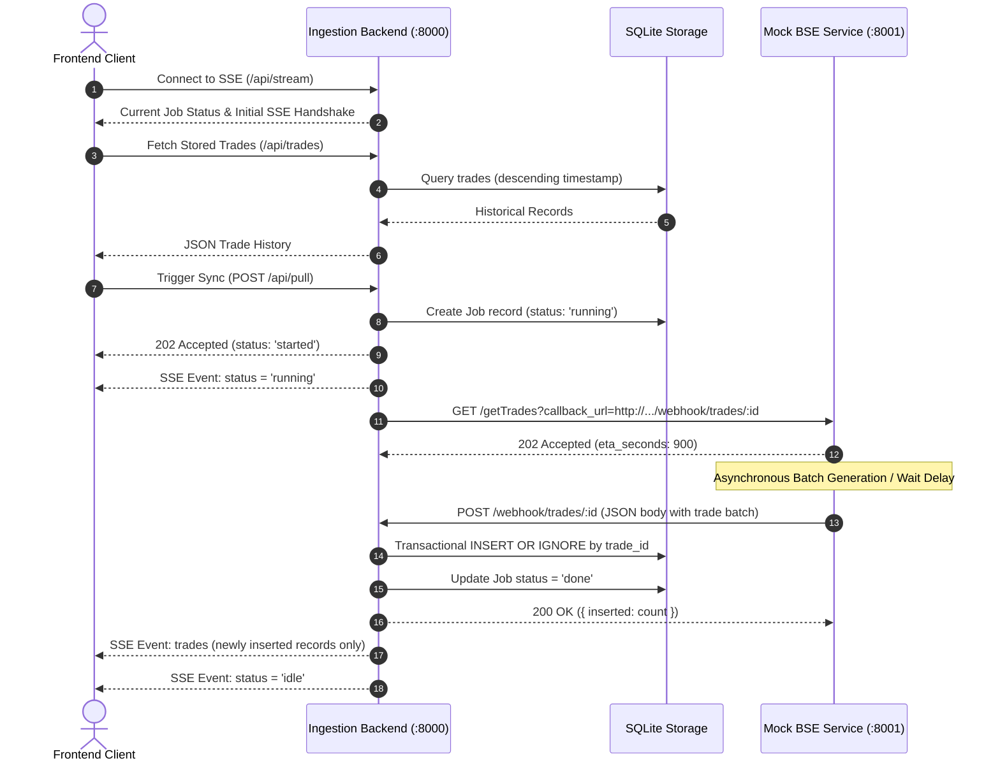

# BSE Trade Synchronization System

An asynchronous, resilient trade ingestion and real-time dashboard platform built to handle batch trade processing from the Bombay Stock Exchange (BSE) mock service without client-side polling.

---

## Overview

Financial exchange interfaces often decouple request initiation from data payload delivery due to computational or generation latency. In this architecture:
1. The ingestion backend triggers a synchronization job against the exchange API, providing an authenticated callback webhook endpoint.
2. The exchange acknowledges the request immediately (`202 Accepted`) and processes the trade records asynchronously.
3. Upon completion, the exchange dispatches the batch payload to the callback webhook with automated exponential-backoff retries.
4. The backend ingests trades within a transactional boundary, deduplicating records by primary key (`trade_id`).
5. New trades and job statuses are published instantaneously to active client dashboards via Server-Sent Events (SSE).

---

## System Architecture

```
+-----------------------------------------------------------------------------+
|                                                                             |
|  +--------------------+         SSE Stream         +---------------------+  |
|  |                    |<===========================|                     |  |
|  |  React Dashboard   |                            |  Ingestion Backend  |  |
|  |  (Vite / Port 5173)|--------------------------->|  (Express/Port 8000)|  |
|  |                    |       POST /api/pull       |                     |  |
|  +--------------------+                            +----------+----------+  |
|                                                               |  ^          |
|                                         GET /getTrades?cb=... |  | Webhook   |
|                                                               v  | POST     |
|                                                    +----------+----------+  |
|                                                    |      Mock BSE       |  |
|                                                    |     Exchange API    |  |
|                                                    |    (Express/8001)   |  |
|                                                    +---------------------+  |
|                                                                             |
+-----------------------------------------------------------------------------+
```

### End-to-End Sequence Flow



---

## Technical Highlights

- **Asynchronous Decoupling**: Prevents HTTP request timeouts across slow or rate-limited external exchange interfaces.
- **Strict Deduplication & Idempotency**: Webhook retries and multiple sync batches do not duplicate trades. SQLite primary key constraints (`trade_id`) combined with transactional `INSERT OR IGNORE` ensure exactly-once ingestion semantics.
- **Server-Sent Events (SSE)**: Real-time update distribution without client-side polling intervals. Connected clients receive instant status transitions and new trade batches.
- **Automatic Reconnection & Heartbeats**: The SSE stream includes a 15-second heartbeat ping (`: ping`) to prevent intermediate proxy connection termination and transparently restores trade state upon reconnection.
- **Concurrent Job Guard**: The backend denies redundant concurrent sync requests while a job is actively running.
- **Deadline Monitoring**: Automated timeout handling flags stale jobs if the exchange fails to respond within the expected processing window.
- **Resilient Webhook Dispatch**: The mock BSE service includes an exponential backoff retry loop (up to 5 attempts) to guarantee webhook delivery.

---

## Project Structure

```
.
|-- backend/
|   |-- index.js             # Core Express server, SQLite operations, SSE pub/sub
|   |-- package.json         # Backend dependencies (express, better-sqlite3)
|   `-- trades.db            # SQLite database file (auto-generated, git-ignored)
|-- frontend/
|   |-- index.html           # HTML document entry
|   |-- vite.config.js       # Vite configuration with /api reverse proxy
|   |-- package.json         # React and Vite dependencies
|   `-- src/
|       |-- App.jsx          # Dashboard UI, SSE listener, table renderer
|       |-- App.css          # Component layout styles
|       |-- index.css        # Global CSS resets
|       `-- main.jsx         # React application root
|-- mock-bse/
|   |-- index.js             # Mock exchange service, deterministic trade generator
|   `-- package.json         # Mock service dependencies (express)
|-- .gitignore               # Ignored artifacts (node_modules, *.db, dist, .env)
`-- README.md                # System documentation
```

---

## Database Schema

The persistence layer uses SQLite (`better-sqlite3`) for fast, zero-configuration local persistence:

### Table: `trades`

| Column | Type | Constraints | Description |
| :--- | :--- | :--- | :--- |
| `trade_id` | TEXT | PRIMARY KEY | Unique exchange transaction identifier |
| `client` | TEXT | NOT NULL | Client identifier (e.g., `CL015`) |
| `symbol` | TEXT | NOT NULL | Equity ticker symbol (e.g., `RELIANCE`, `TCS`) |
| `quantity` | INTEGER | NOT NULL | Executed share volume |
| `price` | REAL | NOT NULL | Executed trade price |
| `timestamp`| TEXT | NOT NULL | ISO 8601 execution timestamp |

### Table: `jobs`

| Column | Type | Constraints | Description |
| :--- | :--- | :--- | :--- |
| `id` | INTEGER | PRIMARY KEY AUTOINCREMENT | Monotonic job identifier |
| `status` | TEXT | NOT NULL | Job state (`running`, `done`, `failed`) |
| `started_at` | INTEGER | NOT NULL | Epoch timestamp (milliseconds) |
| `error` | TEXT | NULLABLE | Error message if status is `failed` |

---

## API Reference

### Backend Service (Port 8000)

#### 1. Retrieve Historical Trades
- **Endpoint**: `GET /api/trades`
- **Response**: `200 OK`
- **Body**:
  ```json
  [
    {
      "trade_id": "T000001",
      "client": "CL014",
      "symbol": "TCS",
      "quantity": 250,
      "price": 3410.50,
      "timestamp": "2026-10-01T03:45:07.000Z"
    }
  ]
  ```

#### 2. Trigger Synchronization Pull
- **Endpoint**: `POST /api/pull`
- **Response Codes**:
  - `202 Accepted`: Job successfully initiated (`{ "status": "started" }`) or already active (`{ "status": "already_running" }`).
  - `502 Bad Gateway`: BSE service unreachable or rejected callback registration (`{ "status": "failed" }`).

#### 3. Webhook Receiver (Exchange Callback)
- **Endpoint**: `POST /webhook/trades/:id`
- **Request Body**:
  ```json
  {
    "trades": [
      {
        "trade_id": "T000001",
        "client": "CL014",
        "symbol": "TCS",
        "quantity": 250,
        "price": 3410.50,
        "timestamp": "2026-10-01T03:45:07.000Z"
      }
    ]
  }
  ```
- **Response**: `200 OK` (`{ "inserted": 1 }`)

#### 4. Real-Time Event Stream (SSE)
- **Endpoint**: `GET /api/stream`
- **Content-Type**: `text/event-stream`
- **Events**:
  - `status`: Dispatched upon connection and state transitions (`{ "state": "idle" | "running" | "failed", "error": null }`).
  - `trades`: Dispatched upon completion of an ingestion batch with array of newly added trade objects.
  - Heartbeat comment: `: ping` emitted every 15 seconds.

---

### Mock BSE Exchange API (Port 8001)

#### 1. Request Trades Pull
- **Endpoint**: `GET /getTrades?callback_url=<URL_ENCODED_ENDPOINT>`
- **Query Parameters**:
  - `callback_url` *(string, required)*: Fully-qualified HTTP endpoint for payload delivery.
- **Response Codes**:
  - `202 Accepted`: Request accepted for asynchronous processing (`{ "status": "accepted", "eta_seconds": 900 }`).
  - `400 Bad Request`: Missing `callback_url`.
  - `503 Service Unavailable`: Simulated failure (when `FAIL_RATE` > 0).

---

## Configuration & Environment Variables

| Variable | Service | Default | Description |
| :--- | :--- | :--- | :--- |
| `BSE_URL` | Backend | `http://localhost:8001` | Base URL of the BSE Exchange API |
| `SELF_URL` | Backend | `http://localhost:8000` | Host address of backend accessible by BSE webhook |
| `PULL_DELAY_SECONDS` | Mock BSE & Backend | `900` | Simulated duration before webhook delivery (seconds) |
| `FAIL_RATE` | Mock BSE | `0` | Probability between 0 and 1 of simulating exchange downtime |

> **Note for Local Testing**: Set `PULL_DELAY_SECONDS=2` in both services for immediate webhook execution during demonstration and test validation.

---

## Getting Started

### Prerequisites

- Node.js (v18.0.0 or higher recommended)
- npm (v9.0.0 or higher)

### Installation

Clone the repository and install dependencies in each directory:

```bash
# 1. Install Mock BSE dependencies
cd mock-bse
npm install

# 2. Install Ingestion Backend dependencies
cd ../backend
npm install

# 3. Install Frontend dependencies
cd ../frontend
npm install
cd ..
```

---

## Running the Application

Open three independent terminal instances to launch the complete system stack.

### Terminal 1: Launch Mock BSE Exchange
```bash
cd mock-bse
# For instant testing without a 15-minute delay:
PULL_DELAY_SECONDS=3 npm start
```
*Service will start listening on http://localhost:8001.*

### Terminal 2: Launch Ingestion Backend
```bash
cd backend
# Mirror the delay variable so deadline calculations match:
PULL_DELAY_SECONDS=3 npm start
```
*Service will initialize SQLite database and listen on http://localhost:8000.*

### Terminal 3: Launch Frontend Client
```bash
cd frontend
npm run dev
```
*Vite development server will be available at http://localhost:5173.*

---

## Verification & Edge Case Scenarios

1. **End-to-End Ingestion Flow**:
   - Access the dashboard at `http://localhost:5173`.
   - Click **Start pull**.
   - Observe the UI status transition to `Pull in progress...` with the button disabled.
   - Once the callback completes, observe the new trades seamlessly render in the table highlighted in green.
   - Confirm status returns to `Idle`.

2. **Deduplication Validation**:
   - Trigger a second pull.
   - The exchange produces overlapping trades.
   - Observe that existing trade records are not duplicated in the table or database.

3. **Concurrency Prevention**:
   - Issue a direct POST request while a pull is running:
     ```bash
     curl -X POST http://localhost:8000/api/pull
     ```
   - Receive `{ "status": "already_running" }` with HTTP status `202`.

4. **Failure Recovery**:
   - Stop the Mock BSE service (`Ctrl+C` in Terminal 1).
   - Click **Start pull** in the dashboard.
   - Observe immediate error handling: `Pull failed: could not start pull: BSE returned... Click Start pull to retry`.

---

## License

This project is licensed under the ISC License.
